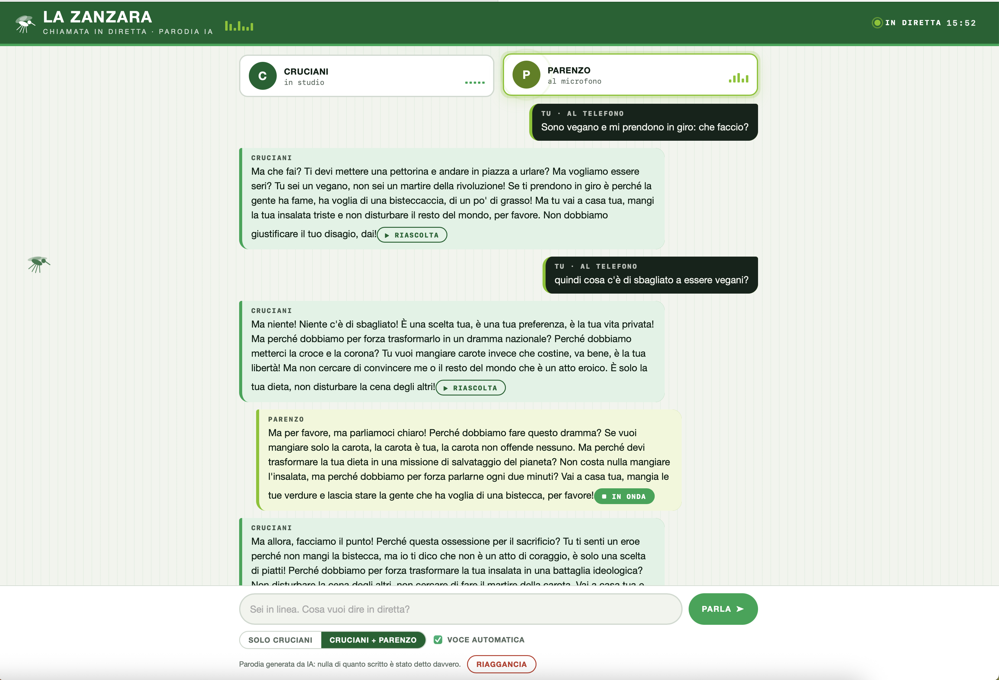

# 🦟 Zanzara AI — chiamata in diretta (parodia)

> *"Pronto, sei in diretta!"*
> Telefoni a un finto Cruciani (e a un finto Parenzo) e loro ti rispondono… con il loro stile, generato da un'IA che gira tutta sul tuo Mac.



## Di cosa si tratta, davvero

Sì, è un progetto **goliardico**: prende le puntate de *La Zanzara* (Radio 24), capisce chi parla, impara come parlano i conduttori e ti fa chiacchierare con loro in una finta diretta radiofonica, voce compresa.

Ma la parodia è solo la scusa. Sotto c'è una **pipeline di IA completa, end-to-end e tutta in locale**, scritta per essere letta e capita. Il progetto è pensato come **base di partenza per imparare**:

| Concetto | Dove lo trovi nel progetto |
|---|---|
| **Speech-to-text** (ASR) | Whisper large-v3 trascrive puntate di 2 ore → `zanzara.py` |
| **Speaker diarization** | pyannote capisce *chi parla e quando* → `zanzara.py` |
| **Embedding e similarità** | impronte vocali (vettori a 256 dimensioni) e coseno per riconoscere le voci → `zanzara.py` |
| **Preparazione di un dataset** | da trascrizioni rumorose a documenti puliti, con filtri per gli errori tipici di Whisper → `dataset.py` |
| **Database vettoriale** | embedding semantici dei turni di parola, ricerca per significato → `rag.py` |
| **RAG** (Retrieval-Augmented Generation) | recupera esempi reali e li usa per guidare l'LLM → `rag.py` |
| **Interazione con un LLM locale** | prompt di sistema, few-shot, temperatura, gestione della memoria della chat via Ollama → `rag.py` |
| **Più agenti che dialogano** | due "personaggi" LLM che vedono la conversazione e si rispondono a vicenda → `rag.py duo` |
| **Fine-tuning con LoRA** | si addestra un piccolo modello esistente sullo stile di un conduttore, poi lo si confronta con il RAG → `finetune.py` |
| **Voice cloning / TTS** | selezione automatica dei campioni audio migliori e sintesi vocale delle risposte → `campioni_voce.py`, `app_web.py` |
| **App web** | server HTTP minimale + pagina HTML, senza framework → `app_web.py`, `pagina.html` |

Tutto gira **in locale**, su un MacBook con 16 GB di RAM: nessuna API a pagamento, nessun dato mandato a servizi di IA esterni. Parte del progetto è anche un esercizio di **sviluppo agentico**: è stato costruito in coppia con un agente di programmazione (Claude Code), un passo alla volta.

Il codice è volutamente semplice, commentato **in italiano** e senza astrazioni inutili: ogni file si legge dall'inizio alla fine.

## Come funziona

```
  Podcast Index ──► mp3 ──► Whisper (testo) ──┐
                       └──► pyannote (voci) ──┴──► unito.json  (chi ha detto cosa)
                                                     │
                       impronte vocali ◄─────────────┤  (dai un nome alle voci una volta,
                       (data/impronte/*.npy)         │   poi le riconosce da solo)
                                                     ▼
                                               dataset.py
                                         turni di Cruciani / Parenzo
                                           │                    │
                                           ▼                    ▼
                                   rag.py (embedding     finetune.py (LoRA su
                                   + LLM con esempi)     un modello piccolo)
                                           │
                                           ▼
                                app_web.py ──► browser  ──► (opzionale) voce clonata
```

1. **Scarica e trascrivi** (`zanzara.py elabora`): prende gli ultimi episodi, li trascrive con Whisper, separa le voci con pyannote e unisce le due cose.
2. **Dai un nome alle voci** (`zanzara.py nomi`): le prime volte ascolti i campioni e dici "SPEAKER_01 è Cruciani". Il sistema salva l'impronta vocale e dalle puntate successive riconosce da solo chi parla.
3. **Costruisci il dataset** (`dataset.py`): unisce le frasi in turni di parola, allega il contesto (cosa ha detto l'altro prima) e scarta i loop di ripetizione di Whisper.
4. **RAG** (`rag.py`): trasforma ogni turno in un vettore; quando fai una domanda recupera i turni più simili e li passa a un LLM locale come esempi di stile.
5. **Fine-tuning** (`finetune.py`): in alternativa al RAG, addestra un adapter LoRA. Con `confronta` vedi i due approcci fianco a fianco.
6. **Chiacchiera** (`app_web.py`): interfaccia web con modalità "solo Cruciani" o "Cruciani + Parenzo".

## Per chi parte da zero: `passi_didattici/`

La cartella [`passi_didattici/`](passi_didattici/) contiene la stessa pipeline spezzata in **6 script piccoli e numerati**, uno per concetto, che lavorano sui primi 10 minuti di una puntata:

1. `01_scarica_episodio.py`: autenticazione a un'API e download
2. `02_trascrivi.py`: trascrizione con Whisper
3. `03_chi_parla.py`: diarizzazione
4. `04_unisci.py`: unire testo e voci (sovrapposizione di intervalli)
5. `05_campioni.py`: ritagliare clip da ascoltare
6. `06_impronte.py`: impronte vocali e similarità del coseno

Se vuoi capire come funziona, comincia da qui.

## Requisiti

- **Mac con Apple Silicon** (M1 o successivi), 16 GB di RAM consigliati. Trascrizione e fine-tuning usano [MLX](https://github.com/ml-explore/mlx); su altre piattaforme vanno sostituiti (ad esempio `faster-whisper` come in `passi_didattici/`, e un'altra libreria per LoRA).
- Python 3.11+ (testato con 3.13)
- [ffmpeg](https://ffmpeg.org/): `brew install ffmpeg`
- [Ollama](https://ollama.com/) con un modello Gemma (il nome si imposta in `MODELLO_LLM` dentro `rag.py`)
- Chiavi gratuite:
  - [Podcast Index](https://api.podcastindex.org/) per l'elenco delle puntate
  - [Hugging Face](https://huggingface.co/settings/tokens), dopo aver accettato le condizioni di [`pyannote/speaker-diarization-3.1`](https://huggingface.co/pyannote/speaker-diarization-3.1) e [`pyannote/wespeaker-voxceleb-resnet34-LM`](https://huggingface.co/pyannote/wespeaker-voxceleb-resnet34-LM)
- *(Opzionale)* un'app di sintesi vocale con API locale su `localhost:3900` per far parlare le risposte (vedi `app_web.py`)

## Installazione

```bash
git clone https://github.com/SCRCCO/zanzara.git
cd zanzara
python3 -m venv .venv
.venv/bin/pip install -r requirements.txt
cp .env.example .env        # e inserisci le tue chiavi
```

## Uso

```bash
# 1. Elabora le ultime 10 puntate (una decina di minuti a puntata; quelle già fatte vengono saltate)
.venv/bin/python zanzara.py elabora --ultimi 10 --pulisci

# 2. Le prime volte: ascolta data/episodi/<id>/campioni/ e dai un nome alle voci
.venv/bin/python zanzara.py nomi <id_episodio> SPEAKER_01=cruciani SPEAKER_03=parenzo

# 3. Costruisci i dataset
.venv/bin/python dataset.py cruciani
.venv/bin/python dataset.py parenzo

# 4. RAG: indicizza una volta, poi gioca
.venv/bin/python rag.py indicizza
.venv/bin/python rag.py cerca "vegani"          # solo la ricerca vettoriale
.venv/bin/python rag.py chiedi "vegani"         # ricerca + risposta dell'LLM
.venv/bin/python rag.py duo                     # Cruciani e Parenzo nel terminale

# 5. Interfaccia web
.venv/bin/python app_web.py                     # poi apri http://localhost:8000

# 6. (Opzionale) Fine-tuning LoRA e confronto con il RAG
.venv/bin/python finetune.py prepara
.venv/bin/python finetune.py allena
.venv/bin/python finetune.py confronta "Sono vegano e mi prendono in giro"
```

Tutti i risultati intermedi finiscono in `data/` (ignorata da git). Ogni passo salva su disco, quindi se interrompi e rilanci riparte da dove era arrivato.

## Cose che si imparano strada facendo

Alcune lezioni pratiche emerse costruendolo, documentate nei commenti del codice:

- Whisper entra in **loop di ripetizione** ("io ero in farmacia io ero in farmacia…"): `condition_on_previous_text=False` aiuta, e un filtro a n-grammi scarta il resto.
- Per dare un nome a una voce non basta una **soglia** di somiglianza: serve anche un **margine** sul secondo candidato, altrimenti un ospite sconosciuto viene scambiato per un conduttore.
- **16 GB sono pochi**: LLM, modello vocale e training non stanno in memoria insieme, quindi bisogna scaricare esplicitamente i modelli da Ollama (`keep_alive: 0`).
- **RAG o fine-tuning?** Il RAG è immediato e "cita" contenuti reali; il LoRA cattura meglio il ritmo ma, con un modello piccolo, inventa di più. `finetune.py confronta` serve proprio a vederlo.

## ⚠️ Avvertenze

- Questa è una **parodia a scopo didattico e di intrattenimento**. Il progetto **non è affiliato** a Radio 24, a *La Zanzara* o ai suoi conduttori.
- Le risposte sono **generate da un'IA**: nulla di ciò che il finto Cruciani o il finto Parenzo dicono è stato detto davvero dalle persone reali.
- Il repository contiene **solo codice**. Non distribuisce audio, trascrizioni, impronte vocali, campioni di voce o modelli addestrati: le puntate sono materiale protetto da diritto d'autore, e voci e impronte vocali sono dati personali.
- La **clonazione della voce** di persone reali è delicata, sia legalmente sia eticamente. Usala solo in privato, non pubblicare audio generati spacciandoli per veri e rispetta le leggi del tuo paese.
- Le stesse tecniche funzionano con qualunque podcast: basta cambiare `FEED_ID` in `zanzara.py`.

## Licenza

Codice rilasciato sotto licenza [MIT](LICENSE).
